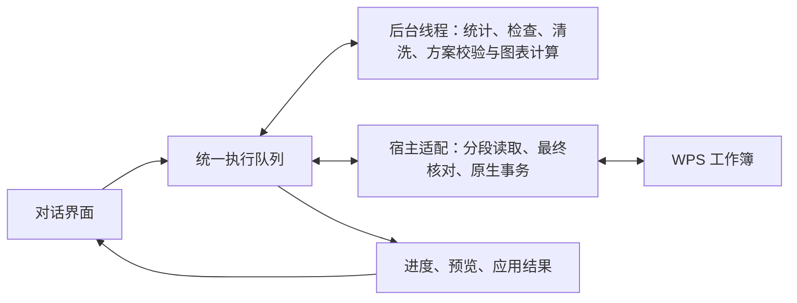

# 统一表格执行模块

聊天界面提交任务并显示消息、进度、预览和执行结果；所有主动表格操作由 `OfficeBridgeExecutor` 排队。一个工作簿同时执行一项任务，后续任务等待前项结束，避免并发写入和恢复记录交叉。

所有选区数据读取、工具查询、统计、检查、清洗、生成修改方案、应用及恢复均走相同入口。被动显示选区地址、连接状态和是否可恢复，只查询轻量元信息。三种 Agent 复用这套执行模块，Agent 原生会话与聊天历史管理不变。

纯数据计算采用同源 Web Worker，使用结构化消息传递数据，不访问 WPS 对象或 DOM。每项计算独立收尾并释放线程，取消时终止线程，不接收迟到结果。Worker 失败、不可用或超时会明确返回错误，不静默改在聊天线程重算。Worker 的隔离和通信方式见 [MDN 官方说明](https://developer.mozilla.org/en-US/docs/Web/API/Web_Workers_API/Using_web_workers)。

WPS 接口由宿主适配层调用。长读取、来源检查及结构操作的恢复基线通过协作调度分段执行，段间让界面处理输入、滚动和停止。图表只记录已读数据/公式和目标表图表集合，不再捕获整个工作簿的单元格格式、行高和列宽。已读取的参考数据仍在应用前核对；无关表内容或边框变化不阻止仅删除本次新增图表。

最后一次核对、原生修改、回读和回滚保持同步事务，防止在让出执行时用户编辑的数据被覆盖。恢复也通过队列执行，其宿主事务仍同步。当前实现不是独立的 WPS 自动化进程，不能中断正在进行的原生调用，也不能保证所有重写入期间界面始终流畅。这是本版的明确边界；后续若实机瓶颈仍落在单个原生调用或写入事务，需要另行验证宿主的进程外自动化能力。

修改仍先预览，用户点击应用才提交。每次成功应用的真实结果回到同一个 Agent 会话，继续剩余步骤；新方案仍等用户应用。取消、失败、放弃、切换文件或新指令不自动继续。用户可以在处理期间输入草稿，发送和表格写入保持串行。

不新增数据库、服务或外部依赖，npm 和 exe 共享代码，执行器和 Worker 都内嵌在便携包中。
