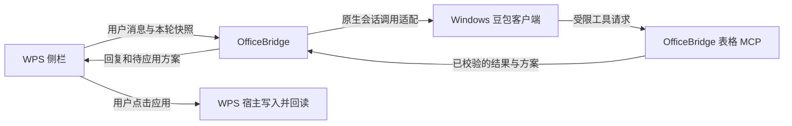

# 豆包如何接入 OfficeBridge

调研日期：2026-10-20。结论来自公开文档、开源源码和当前项目代码；不代表已在本机完成接入。

**有具体路线，Windows 也有实验性开源适配。建议按“原生会话调用 + 表格 MCP”两条通道验证，先做小闭环，再加入侧栏 Agent 列表。** Windows 项目的作者报告只在豆包 2.31.4 的单台电脑上测过有限能力，不能直接承诺本机 2.32.6 完整兼容。[3][6]

## 先区分两件事

| 要解决的问题              | 已找到的能力                                   | 对项目意味着什么                                     |
| ------------------------- | ---------------------------------------------- | ---------------------------------------------------- |
| 让豆包使用外部工具        | 自定义 HTTP 或 STDIO 连接器 [2][9]             | 可研究让豆包调用 OfficeBridge 表格工具               |
| 让 WPS 侧栏调用已登录豆包 | Windows Gateway 包装客户端任务/会话操作 [3][4] | 可以研究发送、续聊、等结果的适配层                   |
| 使用官方业务接入          | 开放平台介绍 Plugin、OpenAPI，仍标注内测 [8]   | 需获得具体接口资料，不能据首页推定可复用个人桌面会话 |

**MCP 连接器解决工具调用，不能单独解决侧栏聊天。** 飞书官方确认豆包工作存在自定义连接器与豆包内的工作入口，但具体能力仍以当前客户端开放情况为准。[1]

## 与需求最接近的开源项目

[codex-doubao-desktop-gateway](https://github.com/ChassyChan/codex-doubao-desktop-gateway) 面向 Windows 10/11 已登录的豆包客户端。它通过本机 CDP 连接客户端，提供创建任务、指定会话续聊、等待和读取结果等工具。[3][4]

源码中的续聊接口接收明确的 `conversationId`，等待接口同时接收 `runId`。这是实现“一条 OfficeBridge 对话对应一条豆包原生会话”的参考基础，无须让 OfficeBridge 重放整段历史。这里是基于接口的实现推断，尚未完成本项目集成。[4]

上游是 [Fullstop000/doubao-cli](https://github.com/Fullstop000/doubao-cli)，其桌面支持说明主要针对 macOS。Windows 项目锁定一个上游提交后应用补丁，并非直接运行最新版上游；实施时应固定和验证整套版本。[5][7]

技术上，这类实现是在客户端已认证的渲染环境中提交内部协议请求，客户端登录状态参与请求流程。它依赖私有行为，不能当成官方 SDK，也不能把本机连接理解为离线推理。[11]

## 连接器路线能做到什么

草料的一手指南给出“新建自定义连接器 → HTTP 地址 → 授权 → 对话中调用”的过程；MediaClaw 则展示 STDIO、本地插件配对的接入案例。它们说明连接器是可以利用的扩展方向，不是 OfficeBridge 已兼容的证明。[2][9]

如果接受在豆包中发指令，可以先研究这个方向：用户在 WPS 选择范围，豆包通过配对后的 OfficeBridge 工具请求读取、分析、生成修改方案，再回 WPS 应用。但这会改变聊天入口，不能作为“始终在 WPS 侧栏聊天”的完整交付。

还要区分“安装成功”和“调用成功”。Patsnap 明确只验证到 macOS 工具发现及任务中选择连接器，没有执行实际业务查询；其说明还要求使用本地电脑环境。[10]

## 按当前目标推进的建议

下面是拟议架构，尚未实现：

我的建议是：以 Windows Gateway 为参考做实验性适配，同时验证豆包能否回调表格 MCP；不要只把一个“豆包”选项加入界面。

当前项目可复用 `TableToolSession`、修改方案校验和 WPS 应用/恢复逻辑。`table-mcp.ts` 目前使用会话专用随机端口与令牌，只有 `WorkBuddyAdapter.run` 绑定当前任务后才能调用；无任务或已取消时会拒绝。**因此不能把现有 MCP 地址复制进豆包就宣称打通。** 还需适配配对、会话归属、每轮快照、方案回传与解绑机制。依据是本地源码，不是外部产品声明。

最小验收应分开进行：

1. 核实客户端身份与连接能力。
2. 在独立原生会话中发送测试消息，再续聊，核对会话 ID 不变。
3. 真实调用受限工具读取一块虚构选区，确认不是模型文字模拟调用。
4. 生成一个新增工作表方案，由用户在 WPS 应用，再回读确认。
5. 测试新对话隔离、取消、失败不发布方案、旧快照不可使用。

上述是真实验证清单，本轮没有执行模型测试。上游虽然提供停止命令，但现有 Windows Gateway 的 MCP 包装没有暴露停止工具，且其作者明确未验证豆包内部 MCP；这两部分必须补验。[4][7]

## 限制与交付边界

- **版本兼容未知。** Windows 项目的有限实测不能推广到其他版本，尤其不能等同于本机完整验收。[3]
- **进程处理不能照搬。** Windows 补丁在正常退出失败后存在强制结束进程的回退，本项目不应把它作为日常自动连接流程。[6]
- **权限需要单独验证。** `AskOnRisk` 不等于只读沙箱，也不保证每个动作都会弹窗；原生文件/命令能力必须与受限表格操作分开验收。[3][7]
- **官方路线需补资料。** OpenAPI 是否支持所需会话、账号、工具以及开放条件，本轮未确认；不能把它直接替代已登录客户端。[8]

此前调试启动被自动审批阻止，不能据此认定豆包不支持调试。当前可靠的说法是：已有可参考实现，但 OfficeBridge 的完整 Windows 豆包接入尚未实现与验收。

## 参考文献

[1] [飞书官网：豆包工作功能、入口和自定义连接器](https://www.feishu.cn/content/article/7677519271848610746)

[2] [草料：在豆包工作中使用 MCP](https://cli.im/open-api/agent/open-platform-mcp/doubao-work.html)

[3] [Windows Doubao Desktop Gateway](https://github.com/ChassyChan/codex-doubao-desktop-gateway)

[4] [Windows Gateway 的 MCP 工具实现](https://raw.githubusercontent.com/ChassyChan/codex-doubao-desktop-gateway/main/src/server.mjs)

[5] [固定上游版本的安装脚本](https://raw.githubusercontent.com/ChassyChan/codex-doubao-desktop-gateway/main/scripts/install-windows.ps1)

[6] [Windows 适配补丁](https://raw.githubusercontent.com/ChassyChan/codex-doubao-desktop-gateway/main/patches/doubao-cli-windows.patch)

[7] [doubao-cli 上游说明](https://github.com/Fullstop000/doubao-cli)

[8] [豆包开放平台](https://open.doubao.com/)

[9] [MediaClaw：豆包工作本地连接器接入](https://mediaclaw.app/features/doubao-integration)

[10] [Patsnap：豆包 MCP 接入及验证边界](https://open.zhihuiya.com/devportal/integrations/doubao)

[11] [doubao-cli 客户端协议实现](https://raw.githubusercontent.com/Fullstop000/doubao-cli/main/src/protocol.mjs)
